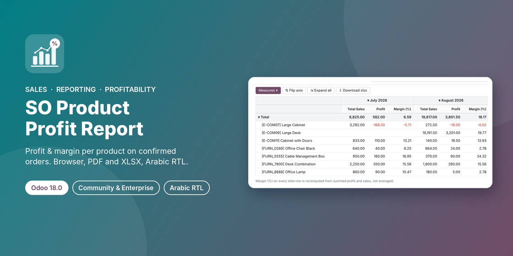

# SO Product Profit Report

**Odoo 18.0 · Community & Enterprise · LGPL-3**

Product profit and margin on confirmed sales orders, with a wizard under
**Sales › Reporting › Product Profit Report**. Show the result on screen
(list, pivot, graph), print a landscape PDF, or export to Excel, in English or
Arabic with full right-to-left layout. No standard Odoo report is overridden.



## Branches

One branch per supported Odoo version. Use the branch that matches your Odoo.

| Branch | Odoo | Notes |
|---|---|---|
| [`16.0`](../../tree/16.0) | Odoo 16.0 | Original release. |
| [`17.0`](../../tree/17.0) | Odoo 17.0 | Locked orders use the new `locked` flag (17.0 dropped the `done` state); optional **Locked** column; `t-out` in the PDF; `column_invisible` in the list. |
| [`18.0`](../../tree/18.0) | Odoo 18.0 | `<tree>` → `<list>`, `view_mode` `list`, `group_operator` → `aggregator`. |  ⬅ this branch
| [`19.0`](../../tree/19.0) | Odoo 19.0 | Weighted ratios computed in SQL via `_read_group_select` (19.0 groups through `formatted_read_group`); `product_uom` → `product_uom_id` handled; `self.env._()` for translations. |

## Features

- **Wizard filters:** start/end date (local time zone, end date inclusive),
  customers (orders of their contacts included), companies, group by
  (none / customer / product / sales order), report language.
- **Show on Browser:** read-only analysis with list, pivot and graph views;
  search filters **Loss Lines** and **Missing Cost**; loss lines in red.
- **PDF:** A4 landscape under your company report layout, KPI cards
  (total sales, total cost, gross profit, margin %, order lines), group
  subtotals and a grand total. A dedicated paper format reserves room for the
  company header, the table header repeats on every page and rows never split.
- **XLSX:** filters on top, frozen header with autofilter, group rows,
  subtotals, grand total, numeric amounts, landscape A4 fitted to page width.
- **Arabic (`ar_001`):** every label, menu, field and message translated;
  PDF and Excel switch to right-to-left, and mixed values such as
  `[E-COM07] Large Cabinet` keep their reading order.

## How the numbers are calculated

| Column | Formula |
|---|---|
| Total Sales | line subtotal (untaxed, after discount) |
| Total Cost | line cost from `sale_margin` × quantity |
| Profit | Total Sales − Total Cost |
| Margin % | Profit ÷ Total Sales × 100 |

Group and grand totals are **weighted**: margin % is recomputed from summed
profit and sales, never averaged across lines (also in pivot and grouped
lists). Amounts are converted to company currency with each order's own rate.
Only confirmed (and locked) orders count; quotations, cancelled orders,
section/note lines and down payments are excluded.

## Installation

1. Copy the `so_product_profit_report` folder from the branch matching your
   Odoo version into your addons path (on Odoo.sh: push this branch, or add
   the repo as a submodule).
2. Update the apps list and install **SO Product Profit Report**.
3. Depends on `sale_management` and `sale_margin`; Python `xlsxwriter`
   (shipped with Odoo).

## Access

| Who | Access |
|---|---|
| Sales / User: All Documents | Menu, wizard, all outputs (read-only analysis) |
| Sales / Administrator | Same |
| Sales / User: Own Documents Only | No access (the report shows product cost) |
| Multi-company | Global record rule: lines of the companies selected in the company switcher |

## Tests

23 `TransactionCase` tests: wizard validation, line and total math, weighted
subtotals, grouping ratios, multi-currency, customer/date/time-zone filters,
cancelled and locked orders, browser/PDF/XLSX outputs, Arabic translation and RTL.

```
odoo-bin -d <db> -i so_product_profit_report --test-tags /so_product_profit_report --stop-after-init
```

## Author

**Ibrahim Yahia** · [LinkedIn](https://www.linkedin.com/in/ibrahim-yahia) ·
ibrahim.yahiah@gmail.com · License: LGPL-3
